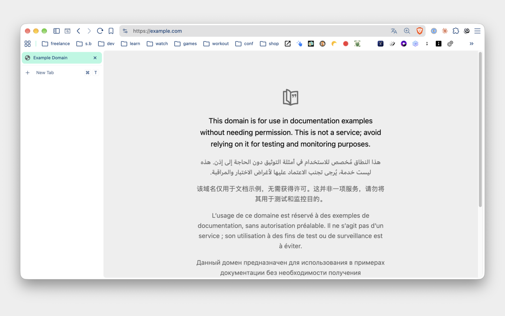
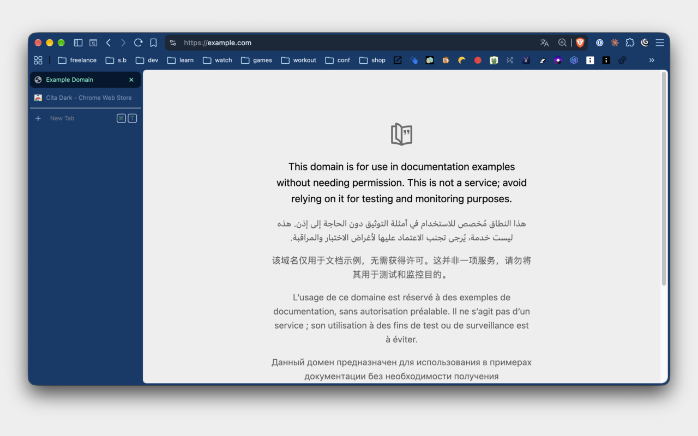

# Cita themes for Chrome

After the VS Code theme, I built a Chrome theme based on my website colors. There's a light and a dark version.

## Install

Search for "Cita Light" or "Cita Dark" in the Chrome Web Store.

You can also load a theme from this repo:

1. Open `chrome://extensions`.
2. Turn on Developer mode.
3. Click Load unpacked.
4. Pick the `cita-light` or `cita-dark` folder.

Chrome allows only one theme at a time, and it doesn't switch themes with the system. To go back to the default theme, open Settings → Appearance → Theme and click Reset to default.

## Files

- `cita-light/` and `cita-dark/` have the themes. Each one has a `manifest.json` and an icon.
- `screenshot-light.png` and `screenshot-dark.png` are the Chrome Web Store screenshots.
- `tile-light.png` and `tile-dark.png` are the Chrome Web Store tiles.
- `icon.svg` is the source of the theme icon.

## Colors

| Part | Cita Light | Cita Dark |
| --- | --- | --- |
| Frame | `#b1f9e2` | `#011830` |
| Toolbar | `#ffffff` | `#0a3a6b` |
| Active tab text | `#043a73` | `#63f2c5` |
| Inactive tab text | `#4f6a8c` | `#9db4d3` |
| Address bar | `#e0fcf3` | `#02264d` |
| Incognito frame | `#d1124a` | `#673352` |

The colors match the other Cita themes:

- **[VS Code](https://github.com/maliMirkec/vs-code-theme)**
- **[iTerm](https://github.com/maliMirkec/iterm-theme)**
- **[Marta](https://github.com/maliMirkec/marta-theme)**
- **[Herdr](https://github.com/maliMirkec/herdr-theme)**
- **[Crest](https://github.com/maliMirkec/crest-theme)**
- **[Spotifast](https://github.com/maliMirkec/spotifast-theme)**
- **[lsd](https://github.com/maliMirkec/lsd-theme)**
